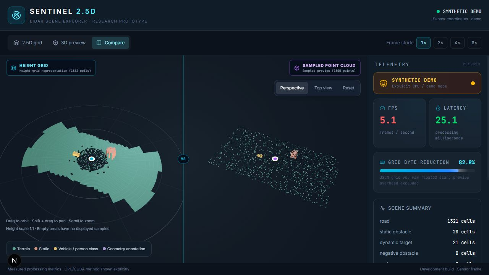
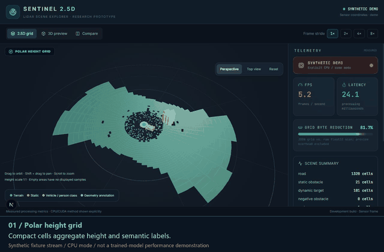

# SENTINEL 2.5D

**LiDAR perception, compact height grids and interactive visualization.**

I implemented the project across Python and CUDA C++ backends, model integration, WebSocket streaming and the Next.js / Deck.gl dashboard. A friend contributed the research. The segmentation model builds on the attributed **Cylinder3D** work.

[Watch the 60-second walkthrough](docs/media/sentinel-walkthrough.mp4) · [Run the demo](#run-the-demo) · [Implementation case study](docs/PORTFOLIO.md)



*Actual dashboard capture using synthetic fixture data in CPU demo mode. Displayed timing is not a trained-model benchmark.*

## What I built

- **Perception integration:** validated float32 scan ingestion, pretrained-model integration, and CUDA C++ preprocessing / aggregation with Python orchestration.
- **Compact representation:** polar height grids with distance-dependent resolution, per-cell height ranges and semantic labels.
- **Streaming backend:** explicit demo, geometric replay and ML modes; measured UTF-8 payload sizes; bounded sends and slow-client handling.
- **Interactive dashboard:** grid, point-cloud and comparison views, perspective / top cameras, frame-stride control and measured telemetry.



## Run the demo

Requires Python 3.10+ and a Node.js version compatible with the locked Next.js dependency. **Demo mode needs no GPU, dataset or model weights.**

From the repository root:

```powershell
python -m pip install -r SENTINEL-2.5D/requirements.txt
cd SENTINEL-2.5D/frontend
npm ci
cd ..
python launch.py --mode demo
```

Open the address printed by the launcher, normally **http://127.0.0.1:3000**. The launcher starts owned services and does not install packages or download assets.

Demo labels are synthetic fixtures. Replay uses a geometric baseline. ML mode requires separately provisioned compatible weights, scans and dependencies; it fails explicitly instead of silently switching to a demo.

## Measurement evidence

Stored local research runs used an **RTX 4060 Laptop GPU**, Python 3.10.11 and PyTorch 2.5.1+cu121. Three warm-up frames were excluded.

| Stored run | Scans | Median processing | 95th percentile |
| --- | ---: | ---: | ---: |
| [Compact FP32](SENTINEL-2.5D/benchmarks/rtx4060-compact.json) | 10 | 88.03 ms | 88.54 ms |
| [Adapted FP16](SENTINEL-2.5D/benchmarks/rtx4060-fp16-folded.json) | 30 | 41.41 ms | 42.71 ms |

These historical records cover scan read, transfer, preprocessing, inference, aggregation, readback, cell assembly and JSON. **Network and browser time are excluded.** The FP16 record starts with a 36,383-point scan; it does not establish sustained 30 FPS or 120K points per frame. No new GPU benchmark was run for this portfolio update.

The earlier 25 ms, 40 FPS, 99.8% reduction and RTX 4090 claims are withdrawn because the repository records do not substantiate them.

## Checks

```powershell
python -m pytest SENTINEL-2.5D/tests -q
cd SENTINEL-2.5D/frontend
npm run build
```

Verified **22 October 2026**: **8 Python tests passed**, **1 CUDA runtime test skipped**, and the frontend production build passed. Tests cover scan validation, exact transport byte counts, grid boundaries, explicit runtime modes, playback and slow-client isolation. [Validation details](docs/VALIDATION.md)

## Engineering trade-offs

A 2.5D cell loses vertically overlapping detail compared with a full point cloud. Empty regions do not prove free space. Vehicle/person classes do not establish motion. Ground-truth segmentation accuracy has not been evaluated, and calibrated localization, planning and control are outside the implemented scope.

The runtime uses Python orchestration with native CUDA C++ components; standalone native deployment has not been verified. The checkpoint adapter includes a legacy-kernel migration, and parity with the original research runtime has not been established.

## Credits

- **Project implementation:** Rohan ([Rohanx777](https://github.com/Rohanx777)).
- **Research contribution:** a collaborating friend.
- **Pretrained model / original research:** [Cylinder3D](https://github.com/xinge008/Cylinder3D), Xinge Zhu and contributors. Adapted source, changes and Apache-2.0 terms are recorded in the [vendor notice](SENTINEL-2.5D/backend/python_legacy/vendor/NOTICE.md).

This is a research prototype. Historical launch and deployment documents describe earlier experiments; use the entry point above for the demonstrated runtime. Dataset and checkpoint files are excluded from Git.
